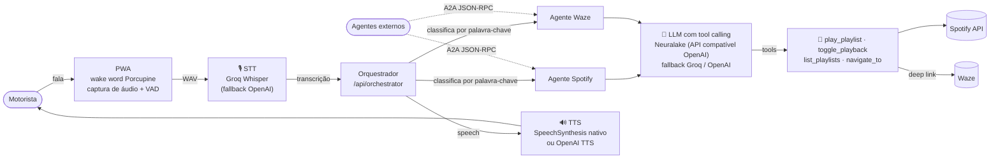

# Finn

Assistente de voz para dirigir: o motorista fala, e agentes de IA tocam música no Spotify e abrem rotas no Waze, sem tirar as mãos do volante.

<!-- DEMO -->

## O problema

Mexer no celular enquanto se dirige é perigoso, e os assistentes de voz genéricos costumam ser lentos ou limitados para ações como "toca minha playlist de treino" ou "me leva para casa". O Finn é um PWA pensado para o uso no carro: ativação por palavra-chave, resposta rápida e ações reais nos apps que o motorista já usa.

## Como funciona

O motorista chama "Finn" (wake word local no navegador) ou toca no botão. O áudio é transcrito, um orquestrador decide qual agente deve atender, e cada agente usa um LLM com **tool calling** para executar a ação de fato. A resposta volta por voz.



Pontos de IA no código:

- **LLM + tool calling:** `runToolLoop` (`src/lib/agent-runtime.ts`) envia as 4 tools em formato OpenAI (`src/lib/contracts/tools.ts`) e executa as chamadas retornadas. Há um modo de resposta em um único round-trip (`FINN_FAST_SPEECH=1`) para reduzir latência.
- **Multiagente:** o orquestrador classifica a fala e dispara os agentes em paralelo (`src/orchestrator/`). Cada agente exporta um Agent Card e também pode ser chamado por outros agentes via **A2A** (`POST /api/agents/{spotify,waze}`).
- **Voz:** wake word com Porcupine, transcrição com Groq Whisper (com fallback para OpenAI) e síntese de voz nativa do navegador ou OpenAI TTS. Há também um fluxo WebRTC com GPT-Live-1 no código, desativado por padrão por custo (`ENABLE_GPT_LIVE=1`).
- **MCP:** o projeto não usa MCP. A interoperabilidade entre agentes é feita por A2A.

## Stack

- Next.js (App Router), React e TypeScript, publicado como PWA na Vercel (região `gru1`)
- LLM: Neuralake (compatível com OpenAI), com fallback Groq e OpenAI
- Voz: Picovoice Porcupine (wake word), Groq Whisper (STT), SpeechSynthesis / OpenAI TTS
- Integrações: Spotify Web API e deep links do Waze
- Upstash Redis para limites de uso por motorista
- Vitest para testes de unidade, aceitação e smoke

## Meu papel

Projeto 100% meu: arquitetura, código, testes e documentação. O desenvolvimento seguiu um fluxo com agentes de IA (`AGENTS.md`, `CLAUDE.md`, `docs/ORQUESTRACAO.md`) e relatórios de revisão em `docs/relatorios/`.

## Estado atual

- MVP funcionando em uso real no carro, como PWA no iPhone.
- Os contratos de isolamento por motorista, custódia do token do Spotify e limites de uso por motorista estão em `docs/contratos/`.
- Convites para outras pessoas ainda **não** estão liberados em produção. O histórico de decisões fica em [`docs/ESTADO_ATUAL.md`](docs/ESTADO_ATUAL.md).
- Persistência durável do perfil do motorista ainda não está em `main`.

## Como rodar localmente

Requisitos: Node.js e npm.

```bash
git clone https://github.com/Jp-mainieri/finn.git
cd finn
npm install
cp .env.example .env.local
```

Para testar sem chaves de API, use o cliente LLM simulado. No `.env.local`, defina:

```bash
FINN_USE_MOCKS=1
FINN_LEGACY_TOKEN_ENABLED=1   # só para dev local: aceita o token legado
FINN_API_TOKEN=<openssl rand -hex 32>
```

Com isso, `POST /api/orchestrator` com `Authorization: Bearer <FINN_API_TOKEN>` e `{"transcript":"toca minha playlist de treino"}` roda o orquestrador, e o LLM simulado devolve a tool call `play_playlist`. O Spotify responde "não configurado" até você preencher as credenciais dele.

Para usar os serviços reais, preencha no `.env.local` as chaves descritas em `.env.example` (Neuralake ou Groq/OpenAI, Spotify, Picovoice). Em produção o acesso é por convite emitido pelo dono (`npm run invite:create`), não pelo token legado.

```bash
npm run dev      # http://localhost:3000
npm test         # testes (Vitest)
npm run typecheck
npm run build
```

A arquitetura completa está em [`docs/ARCHITECTURE.md`](docs/ARCHITECTURE.md).
